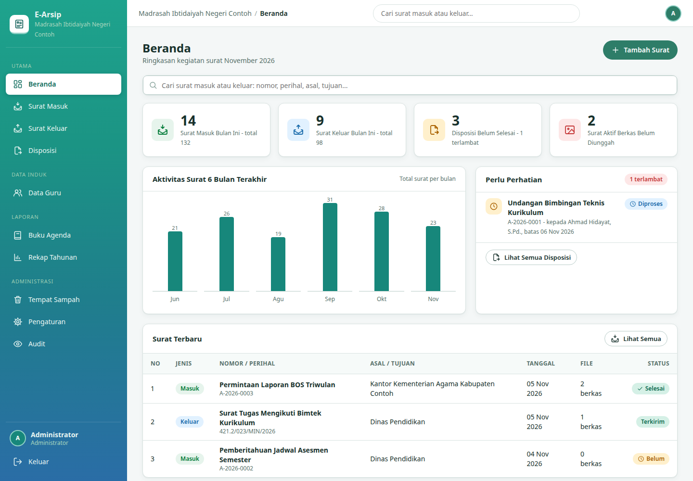
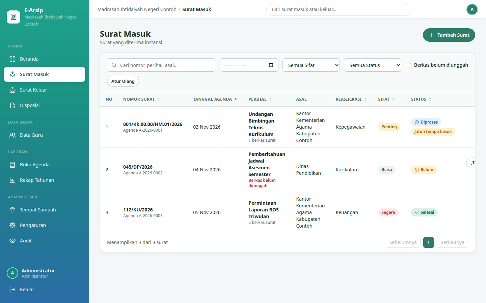
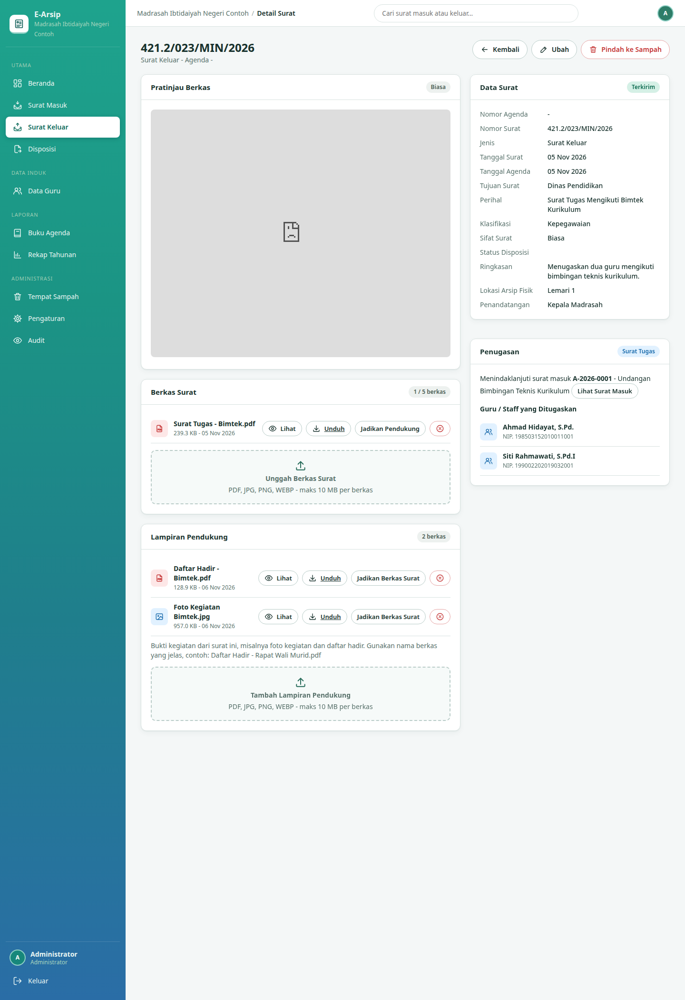
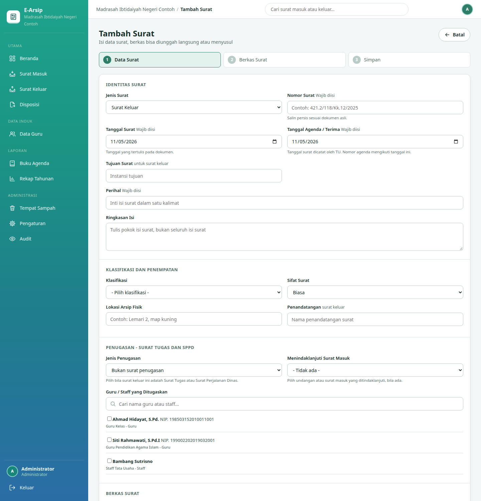
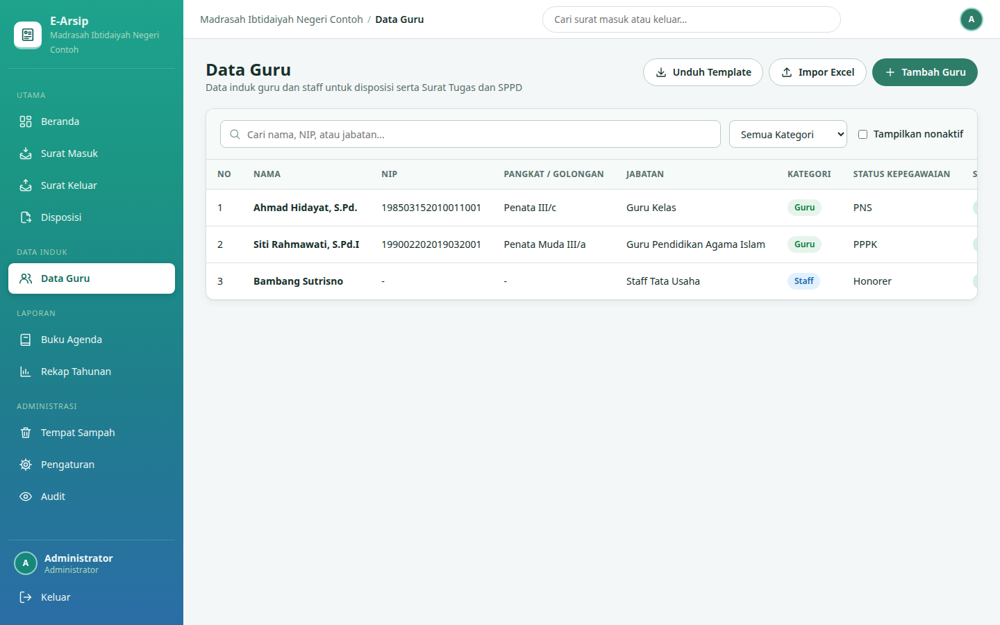

# E-Arsip - Arsip Surat Masuk dan Keluar Madrasah

Aplikasi arsip surat masuk dan keluar untuk madrasah dan instansi pendidikan, berjalan sepenuhnya di Cloudflare (Workers + D1 + R2). Satu Worker melayani halaman, API, dan login; tidak ada server yang perlu dirawat dan biaya mulai dari nol rupiah pada kuota gratis Cloudflare.

Catat surat dulu, berkas menyusul: nomor agenda terbit otomatis begitu surat dicatat, disposisi bisa langsung berjalan, dan berkas hasil pindai dilengkapi kemudian. Setiap surat yang belum punya Berkas Surat ditandai jelas sampai dilengkapi.



## Fitur utama

**Surat masuk dan keluar**
- Nomor agenda masuk otomatis per tahun (format A-2026-0001) dan peringatan nomor surat keluar ganda.
- Klasifikasi (Umum, Kurikulum, Kepegawaian, Keuangan, Sarana dan Prasarana, bisa ditambah), sifat surat Biasa/Penting/Segera/Rahasia, lokasi arsip fisik, dan penandatangan.
- Filter status, sifat, bulan agenda, pencarian, dan sortir klik pada kepala kolom di semua tabel.

**Berkas dua jenis**
- *Berkas Surat*: pindaian surat itu sendiri. Kelengkapan surat hanya dihitung dari jenis ini (maksimal 5 per surat).
- *Lampiran Pendukung*: bukti kegiatan dari surat keluar, misalnya daftar hadir dan foto kegiatan (total semua berkas maksimal 10 per surat, 10 MB per berkas).
- Jenis berkas bisa dipindah dari halaman detail. Pratinjau PDF dan gambar langsung di aplikasi.

**Disposisi**
- Alur Baru, Diproses, Selesai, dengan batas waktu dan penanda tenggat (lewat batas, jatuh tempo besok, dan seterusnya).
- Lembar disposisi siap cetak, dan status surat tersinkron otomatis dari disposisinya.

**Data Guru/Staff dan penugasan**
- Data induk guru dan staff: nama, NIP opsional dan unik, pangkat/golongan, jabatan, kategori, status kepegawaian, dan status aktif.
- Impor dari Excel atau CSV dengan template resmi, pratinjau per baris (siap, duplikat, gagal), dan NIP ganda ditolak.
- Surat keluar bisa ditandai sebagai Surat Tugas atau SPPD, ditautkan ke surat masuk yang ditindaklanjuti (misalnya undangan), dan diisi daftar guru yang ditugaskan. Nama penerima disposisi dibantu daftar guru aktif.

**Laporan**
- Buku Agenda per tahun ajaran atau tahun kalender dan Rekap Tahunan: ringkasan PDF, buku agenda PDF, dan tiga berkas CSV.
- Kop surat diatur dari formulir Pengaturan (tiga baris kop, alamat, kontak, logo, gaya garis) dan mengikuti format ketentuan Kemenag. Tidak ada nama instansi yang tertanam di kode.

**Pengguna, peran, dan audit**
- Empat peran: Admin, Petugas, Pimpinan, Viewer. Surat Rahasia disamarkan untuk Viewer.
- Kelola pengguna penuh: tambah, ubah nama dan peran, aktif/nonaktif, dan atur ulang kata sandi oleh admin.
- Semua aktivitas penting tercatat di halaman Audit (khusus admin). Semua tabel memakai pagination.
- Tempat Sampah dengan pulihkan dan hapus permanen, plus tombol Batalkan sesudah surat dipindah.
- Zona waktu tampilan WIB, WITA, atau WIT; pencarian gabungan dari bilah atas.

## Tangkapan layar

Daftar surat masuk, lengkap dengan penanda tenggat dan penanda berkas yang belum diunggah:



Detail surat keluar: Berkas Surat dan Lampiran Pendukung terpisah, plus kartu Penugasan berisi surat masuk induk dan guru yang ditugaskan:



Formulir surat keluar dengan bagian Penugasan (jenis penugasan, surat masuk induk, pilihan guru):



Data Guru sebagai data induk untuk disposisi dan penugasan, bisa diimpor dari Excel:



## Spesifikasi teknis singkat

| Aspek | Isi |
|---|---|
| Runtime | Cloudflare Workers, satu berkas `worker.js` hasil rakitan (ES module) |
| Bahasa | JavaScript (backend dan frontend), Python 3 untuk build, deploy, dan skema |
| Database | Cloudflare D1 (SQLite), skema di `database/schema.sql` |
| Penyimpanan berkas | Cloudflare R2 privat; berkas hanya bisa diakses lewat Worker sesudah login |
| Frontend | HTML + CSS + JavaScript murni, satu berkas, tanpa framework dan tanpa langkah bundel |
| Autentikasi | Cookie sesi HttpOnly, kata sandi di-hash PBKDF2-SHA256 100.000 iterasi |
| Binding Worker | `DB` (D1) dan `FILES` (R2) |
| Batas berkas | PDF/JPG/PNG/WEBP, dicek dari magic bytes, maks 10 MB per berkas |
| Lisensi | MIT |

Rincian lengkap: model data, daftar endpoint API, aturan peran, dan batasan sistem ada di [docs/SPESIFIKASI.md](docs/SPESIFIKASI.md).

## Instalasi

Prasyarat: akun Cloudflare, Python 3, dan API token Cloudflare dengan izin Workers Scripts Edit, D1 Edit, dan Workers R2 Storage Edit.

1. Fork atau clone repo ini.
2. Buat database D1 dan bucket R2 (dashboard Cloudflare atau `npx wrangler d1 create e-arsip-db` dan `npx wrangler r2 bucket create e-arsip-files`). Catat UUID database.
3. Atur variabel lingkungan:

   ```bash
   export CF_API_TOKEN=token-anda
   export CF_ACCOUNT_ID=id-akun-anda
   export CF_D1_ID=uuid-database-anda
   # opsional: CF_R2_BUCKET (bawaan e-arsip-files), CF_SCRIPT_NAME (bawaan e-arsip), ADMIN_PW
   ```

4. Terapkan skema dan buat akun admin awal:

   ```bash
   python3 run_schema.py
   ```

5. Deploy:

   ```bash
   python3 deploy.py --with-r2
   ```

6. Buka alamat Worker Anda, masuk dengan pengguna `admin` dan kata sandi dari `ADMIN_PW` (bawaan `admin123`), lalu **segera ganti kata sandi** di Pengaturan dan isi kop instansi Anda.

Alternatif deploy memakai Wrangler: salin `wrangler.toml.example` menjadi `wrangler.toml`, isi UUID database, jalankan `python3 build.py` lalu `npx wrangler deploy`.

## Memperbarui instalasi yang sudah berjalan

Skema versi terbaru juga tersedia sebagai migrasi berurutan di `database/migrations/`:

- `0001_skema_awal.sql` - skema dasar (pengguna, surat, lampiran, disposisi, audit, pengaturan).
- `0002_guru_berkas_penugasan.sql` - tabel guru dan relasi penugasan, kolom jenis berkas, dan tautan surat induk.

Terapkan berkas yang belum pernah dijalankan secara berurutan, misalnya `npx wrangler d1 execute e-arsip-db --remote --file database/migrations/0002_guru_berkas_penugasan.sql`. Untuk instalasi baru, `database/schema.sql` sudah memuat semuanya sekaligus.

## Struktur repo

```
src/            sumber Worker: backend.js, frontend.html, terra.css, sprite.svg.txt
build.py        merakit src/ menjadi worker.js (frontend tertanam sebagai base64)
deploy.py       deploy ke Cloudflare lewat API (token dari variabel lingkungan)
run_schema.py   menerapkan schema.sql ke D1 dan membuat akun admin awal
database/       schema.sql (instalasi baru) dan migrations/ (pembaruan berurutan)
docs/           SPESIFIKASI.md dan screenshots/
wrangler.toml.example  contoh konfigurasi Wrangler
```

Jangan sunting `worker.js` secara langsung; sunting berkas di `src/` lalu jalankan `build.py`.

## Keamanan

- Ganti kata sandi admin bawaan sebelum aplikasi dipakai orang lain.
- Bucket R2 bersifat privat secara bawaan; jangan ubah menjadi publik.
- Surat bersif
...[truncated 375 chars]